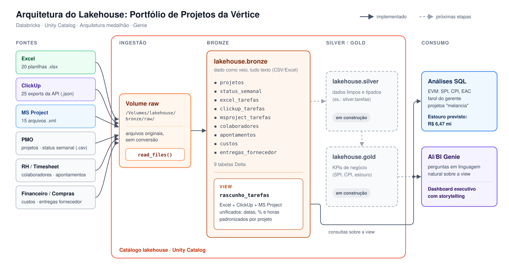
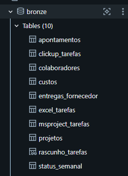
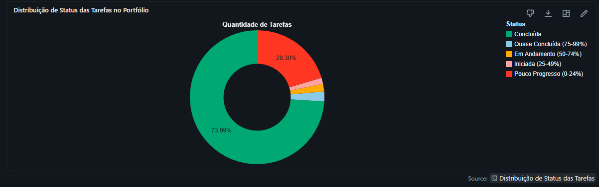
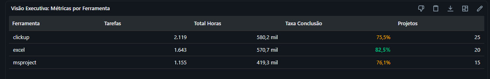
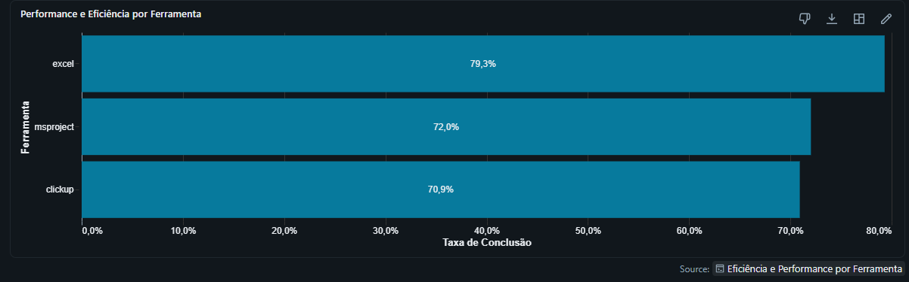
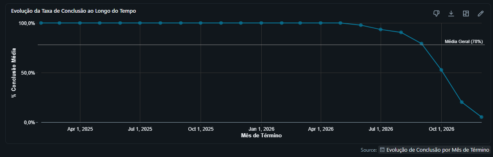
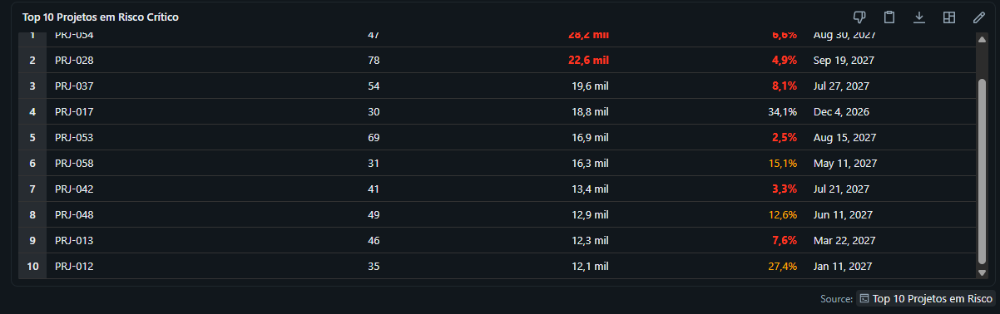
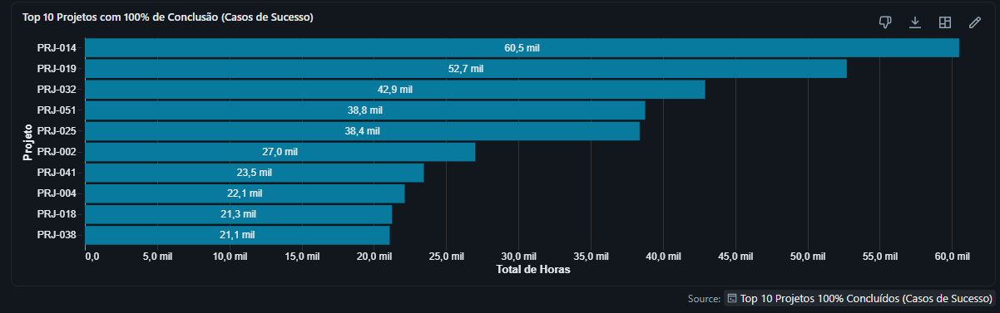
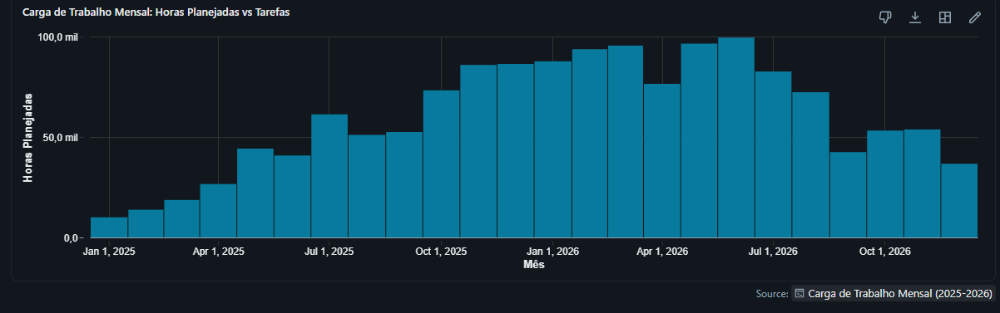
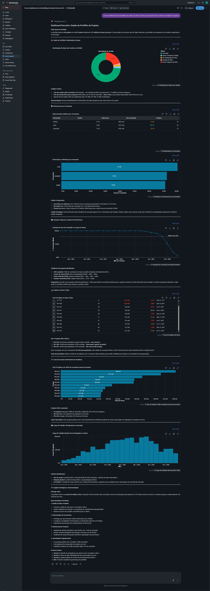

# Lakehouse de Portfólio de Projetos · Databricks

Projeto de engenharia e análise de dados no **Databricks** que consolida o portfólio de projetos da **Vértice**, uma empresa cujos projetos estão espalhados em três ferramentas diferentes (Excel, ClickUp e MS Project), além de dados de PMO, RH, timesheet, financeiro e compras.

O objetivo é responder, com dados, às perguntas do dono da empresa:

1. **Quem atrasa?** Quais projetos e ferramentas estão fora do prazo.
2. **Quanto custa?** Se nada mudar, quanto a carteira vai estourar o orçamento.
3. **Onde há gente parada?** Horas disponíveis vs. horas apontadas.

> 🚧 **Projeto em evolução.** A camada **bronze** e a view de negócio estão prontas. As camadas **silver** e **gold** ainda estão em construção.

---

## Arquitetura



O projeto segue a **arquitetura medalhão** dentro de um único catálogo do Unity Catalog:

| Camada | Local | Papel | Status |
|---|---|---|---|
| **Raw** | Volume `lakehouse.bronze.raw` | Arquivos originais, exatamente como chegaram (CSV, XLSX, JSON, XML) | ✅ |
| **Bronze** | Schema `lakehouse.bronze` | Tabelas Delta com o dado preservado como veio, sem limpeza | ✅ |
| **Silver** | Schema `lakehouse.silver` | Dados limpos, tipados e unificados (ex.: `silver.tarefas`) | 🚧 |
| **Gold** | Schema `lakehouse.gold` | KPIs de negócio prontos para consumo | 🚧 |
| **Consumo** | Análises SQL + AI/BI Genie | Respostas de negócio e storytelling executivo | ✅ |

Hoje as análises e a Genie consomem a view `bronze.rascunho_tarefas`. Quando a silver e a gold estiverem prontas, o consumo passará a apontar para elas.

---

## Fontes de dados

Todos os arquivos ficam no volume `/Volumes/lakehouse/bronze/raw/`, organizados por sistema de origem:

| Pasta | Sistema | Formato | Conteúdo |
|---|---|---|---|
| `pmo/` | PMO | CSV | `projetos.csv` (cadastro: cliente, valor, prazo, ferramenta) e `status_semanal.csv` (farol publicado toda sexta) |
| `excel/` | Excel | XLSX | 20 planilhas de cronograma, uma por projeto, cada gerente no seu formato |
| `clickup/` | ClickUp | JSON | 25 exports da API, uma lista (projeto) com as tarefas dentro |
| `msproject/` | MS Project | XML | 15 arquivos, uma `<Task>` por tarefa, com fases e baseline |
| `rh/` | RH | CSV | `colaboradores.csv` (520 pessoas: papel, senioridade, custo/hora) |
| `timesheet/` | Timesheet | CSV | `apontamentos.csv` (horas disponíveis x apontadas por semana) |
| `financeiro/` | Financeiro | CSV | `custos.csv` (lançamentos de custo real por projeto) |
| `compras/` | Compras | CSV | `entregas_fornecedor.csv` (prometido x entregue por consultoria) |

---

## O que foi construído

Todo o código está em [`notebooks_lakehouse/migracao.ipynb`](notebooks_lakehouse/migracao.ipynb), em SQL.

### 1. Ingestão bronze: 9 tabelas Delta

Um único comando, `read_files`, lê CSV, Excel, JSON e XML direto do volume, sem nenhuma conversão prévia dos arquivos.



| Tabela | Origem | Observação |
|---|---|---|
| `projetos` | PMO | Cadastro do PMO, inclui em qual ferramenta cada projeto vive |
| `status_semanal` | PMO | Farol e bloqueios publicados pelos gerentes |
| `excel_tarefas` | Excel | As 20 planilhas lidas de uma vez; colunas renomeadas, valores intactos |
| `clickup_tarefas` | ClickUp | `explode()` abre a lista de tarefas: uma linha por tarefa |
| `msproject_tarefas` | MS Project | Uma linha por `<Task>`, inclusive as tarefas-resumo |
| `colaboradores` | RH | Cadastro de pessoas e custo/hora |
| `apontamentos` | Timesheet | Horas por pessoa, projeto e semana |
| `custos` | Financeiro | Custo real por projeto |
| `entregas_fornecedor` | Compras | Entregas das consultorias |

Decisões de design da bronze:

- **`inferColumnTypes => false` em CSV e Excel.** Tudo entra como texto. Assim, datas em dois formatos e valores com vírgula decimal não são "corrigidos" silenciosamente antes de a sujeira ser vista.
- **Inferência mantida em JSON e XML**, para preservar a estrutura aninhada (listas dentro de listas).
- **`_rescued_data` removida.** É a rede de segurança do `read_files` para dados que não cabem nas colunas; nesses arquivos ela vem vazia.
- **Coluna `arquivo`** (`_metadata.file_name`) guardada nas tabelas das ferramentas, para rastrear a origem de cada linha.

### 2. View de negócio: `bronze.rascunho_tarefas`

Unifica as tarefas das três ferramentas em um só formato:

| Coluna | Descrição |
|---|---|
| `projeto_id` | Código `PRJ-xxx` (extraído do nome do arquivo ou do cadastro do PMO) |
| `ferramenta` | `excel`, `clickup` ou `msproject` |
| `tarefa` | Nome da tarefa |
| `inicio_baseline`, `fim_baseline` | Datas planejadas |
| `pct_concluido` | Percentual concluído (0 a 100) |
| `horas` | Horas previstas |

Tratamentos aplicados em cada fonte:

- **Excel:** datas `dd/MM/yyyy` ou número de série do Excel; `%` em texto (`'64,4%'`) ou fração (`0.45`); exclusão da linha `TOTAL`.
- **ClickUp:** `projeto_id` obtido pelo cadastro do PMO; datas e progresso extraídos dos campos personalizados com `filter()`; milissegundos convertidos em datas e horas.
- **MS Project:** datas lidas da estrutura `Baseline`; horas no formato `PT40H0M0S`; apenas tarefas reais (`Summary = 0`), para não contar a fase duas vezes.

### 3. Análises de negócio (EVM)

Com a view e as tabelas de custo e status, o notebook calcula indicadores de **Earned Value Management** por projeto:

- **SPI** (prazo), **CPI** (custo) e **estouro previsto** (EAC − orçamento).
- Comparação com o **farol do gerente**, revelando os projetos "melancia": verdes por fora, vermelhos por dentro.
- **Estouro previsto da carteira: R$ 6,47 milhões**, somando apenas os projetos que estouram.

### 4. Storytelling com AI/BI Genie

A partir da view `rascunho_tarefas`, foi criado um espaço **Genie** para fazer perguntas sobre o portfólio em linguagem natural. Com ele, foi gerado um **dashboard executivo com storytelling**, que organiza os insights em uma narrativa para a gestão. Visão geral: **60 projetos, 4.917 tarefas e 1,57 milhão de horas planejadas**.

#### Saúde do portfólio

Distribuição das tarefas por faixa de conclusão.



#### Performance por ferramenta

Excel, ClickUp e MS Project comparados em volume de tarefas, horas e taxa de conclusão.





#### Evolução temporal

Taxa média de conclusão das tarefas por mês de término.



#### Projetos em risco crítico

Top 10 projetos por horas pendentes, com percentual concluído e prazo.



#### Casos de sucesso

Top 10 projetos 100% concluídos, por total de horas entregues.



#### Carga de trabalho

Horas planejadas por mês ao longo de 2025 e 2026.



O dashboard fecha com **recomendações** priorizadas e próximos passos para a gestão.

<details>
<summary>📊 Ver o dashboard completo gerado pela Genie</summary>



</details>

---

## Como executar

### Pré-requisitos

- Workspace Databricks com **Unity Catalog** habilitado.
- SQL Warehouse ou cluster com suporte a `read_files` nos formatos CSV, JSON, XML e Excel.
- Permissão para criar catálogo, schemas e volumes.

### 1. Criar catálogo, schemas e volume

```sql
CREATE CATALOG IF NOT EXISTS lakehouse;

CREATE SCHEMA IF NOT EXISTS lakehouse.bronze;
CREATE SCHEMA IF NOT EXISTS lakehouse.silver;
CREATE SCHEMA IF NOT EXISTS lakehouse.gold;

CREATE VOLUME IF NOT EXISTS lakehouse.bronze.raw;
```

### 2. Subir os arquivos para o volume

Envie os arquivos para `/Volumes/lakehouse/bronze/raw/`, respeitando a estrutura de pastas da seção [Fontes de dados](#fontes-de-dados). Isso pode ser feito pela interface do Catalog Explorer (**Upload to volume**) ou pela Databricks CLI:

```bash
databricks fs cp -r ./raw dbfs:/Volumes/lakehouse/bronze/raw --profile SEU-PERFIL
```

### 3. Rodar o notebook

Importe `notebooks_lakehouse/migracao.ipynb` no workspace e execute as células em ordem:

| Célula | O que faz |
|---|---|
| 1 | Cria as 9 tabelas da bronze e mostra a contagem de linhas de cada uma |
| 2 | Cria a view `bronze.rascunho_tarefas` |
| 3 | SPI, CPI, farol e estouro por projeto |
| 4 | Estouro previsto da carteira (R$ 6,47 mi) |

Se alguma tabela vier com 0 linhas na conferência da célula 1, o arquivo correspondente não foi enviado ao volume.

### 4. Criar o espaço Genie

No Databricks, crie um espaço **Genie** e adicione a view `lakehouse.bronze.rascunho_tarefas` como fonte de dados.

---

## Estrutura do repositório

```
databricks/
├── README.md
├── docs/
│   ├── arquitetura.svg            # diagrama da arquitetura
│   └── img/
│       ├── arquitetura.png        # versão PNG do diagrama
│       ├── catalogo-bronze.png    # tabelas da bronze no Catalog Explorer
│       ├── genie-storytelling.png # dashboard completo gerado pela Genie
│       └── genie/                 # gráficos do dashboard, um por tema
└── notebooks_lakehouse/
    └── migracao.ipynb             # ingestão bronze, view e análises
```

---

## Próximos passos

- [ ] **Silver:** materializar `silver.tarefas` a partir da view, com tipos corretos e regras de qualidade.
- [ ] **Silver:** tratar as demais tabelas (custos, status, apontamentos, colaboradores, entregas).
- [ ] **Gold:** tabelas de KPIs (SPI, CPI, estouro, ociosidade da equipe).
- [ ] **Consumo:** apontar a Genie e as análises para a camada gold.
- [ ] **Orquestração:** agendar o pipeline com Databricks Jobs.

---

## Tecnologias

Databricks · Unity Catalog · Delta Lake · Databricks SQL · `read_files` · AI/BI Genie
